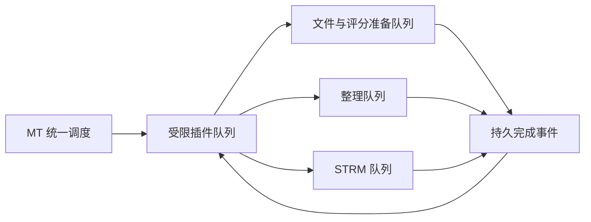

# 调度、执行队列与完成事件

MT 统一调度器保存唯一的定时定义。插件设置和全局定时任务管理操作同一条记录；不要在业务 storage 中另外维护 Cron、启用状态或进程定时器。



创建周期任务需要 `triggers.manage`。一个插件可以创建多条定时；不含文件字段的动作不要求文件选择。

```ts
const schedule = mt.triggers.schedules.create({
  name:'每日目录扫描', kind:'cron', cron:'0 3 * * *', timezone:'Asia/Shanghai',
  enabled:false, request:{action:'scan-files',selections:[{rootId:'授权目录ID',path:'.'}],input:{}}
});
```

五段 Cron 的顺序为分钟、小时、日、月、星期。`Local` 表示 MT 服务端时区。一次性任务使用 `kind:'once'`、`at:'2026-12-01T03:00:00+08:00'`、`cron:''`。一次性时间必须含时区偏移。`list` 返回下次执行时间；`update` 必须携带当前 `revision`。首次启用和恢复用户暂停的任务由宿主界面完成，SDK 不能设置这些状态。

启用、修改和立即运行均重新验证参数、资源和安装身份。保存失败不会留下已生效的内存任务。MT 重启不补跑过期一次性任务或错过的周期点。同一定时的上一条流程仍在运行或等待业务任务时，跳过本次触发并保留原因。

耗时业务返回持久 `task.ref`；不要保存队列整数 ID。用 `tasks.get/list/items/cancel` 管理本插件任务。逐项结果按 `offset/limit` 分页，`nextOffset:-1` 表示结束。查询不会获得其他插件任务或全局原始日志。

```ts
const run=mt.runtime.info();
const task=mt.files.scan({rootId:'授权目录ID',path:'.',limit:1000,idempotencyKey:run.runId+':scan'});
mt.tasks.wait({refs:[task.ref],completion:{action:'collect-report',input:{}}});
return {message:'等待扫描完成'};
```

`tasks.wait` 只登记依赖和完成动作，随后必须返回；之后继续调用 SDK 会得到 `FLOW_WAITING`。工作进程退出，流程仍为 `waiting`。完成事件包含任务摘要，失败/取消任务也可进入完成动作，由作者决定如何展示部分结果。结果未知的任务不会自动续跑。动作链不能重复祖先动作，最大深度 16。

方案完成订阅使用 `events.subscribe`，同时需要单独选择方案事件授权。`triggers.events.create/update/list/pause/delete` 管理订阅，初次启用仍由用户操作。事件包含 `kind/profileId/status/total/completed/failed`，不含路径、原始错误、FF 数据或凭据。插件启动的业务不会产生方案订阅事件，避免同插件和跨插件循环；自身业务完成仍可使用 `tasks.wait`。每插件待投递方案事件最多 100 条，达到上限暂停订阅并显示原因。

未启动事件可重试投递，事件 ID 去重。安装修订、授权、订阅内容或父流程状态变化会取消旧投递。已经启动后中断的变更动作不重放。作者可用 `event.id` 建立自身幂等边界，但不能据此伪造宿主事件。

三个取消动作的含义不同：暂停定时停止未来触发；取消插件流程停止脚本及后续完成动作；取消业务任务停止对应队列任务。已经完成的文件操作不回滚。插件停用阻止新调用和回调，已交给 MT 的整理、STRM 任务继续由业务队列管理。
